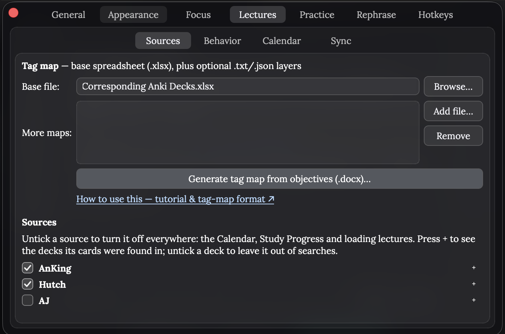
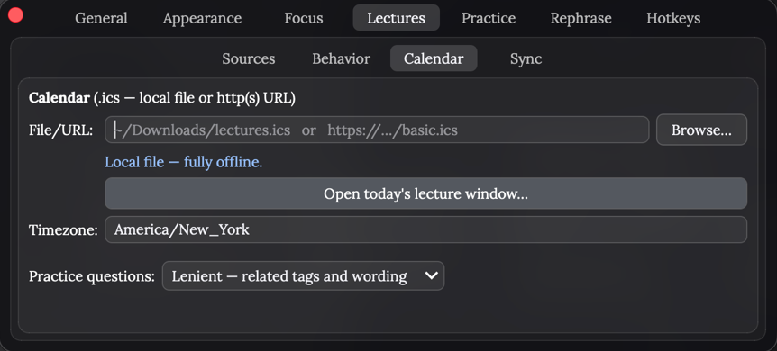

# Load Today's Lectures

*Unsuspend today's lecture cards, offline, in one click.*

Janki matches your class schedule to your cards and **unsuspends** today's. It all
runs **locally**. Open it from **Tools → Load today's lectures** (full Janki or the
standalone `load-todays-lectures.ankiaddon`).

A calendar is optional: with one, today's lectures are picked for you (and can load
automatically each day); without one, you tick them yourself.

---

## Find a tag map

A **tag map** lists the tags or decks for each lecture. Your class may already share
one (Janki testers: see the [setup page](https://cjre.pl/ogle/janki/setup/)), or make
your own:

<details>
<summary><b>Spreadsheet (.xlsx)</b>, recommended</summary>

One sheet per course. Each block of lectures has a **Corresponding Decks/Tags**
header; Janki reads the columns around it:

| Lecture | Corresponding Decks/Tags | AnKing |
|---|---|---|
| Amino Acid Disorders | `deck:"AJ::Biochem::Amino acids"` | `#AK_Step1_v12::Biochem::Amino_acids` |

Blocks can sit side by side (e.g. one per biweekly).

</details>

<details>
<summary><b>Text file (.txt)</b></summary>

Lecture name between two `====` lines, then its tags (`#…`, `tag:…` or `deck:…`):

```text
====================
Amino Acid Disorders
====================
#AK_Step1_v12::Biochem::Amino_acids
deck:"AJ::Biochem::Amino acids"
```

</details>

<details>
<summary><b>JSON (.json)</b></summary>

```json
{ "Amino Acid Disorders": ["#AK_Step1_v12::Biochem::Amino_acids"] }
```

</details>

`#AK…` tags match on their last part, so maps keep working across AnKing versions.

---

## Settings

**Tools → Janki: Settings… → Lectures**

- **Sources**: your tag map, extra `.txt/.json` maps, and which decks to search.
- **Behavior**: daily auto-load and matching options (defaults are fine).
- **Calendar**: an `.ics` file or URL, and your timezone.
- **Sync**: carry your lecture setup between computers (encrypted).

<p align="center"></p>

<p align="center"></p>

*Everything stays on your machine; the network is only used for a calendar URL or Sync.*
